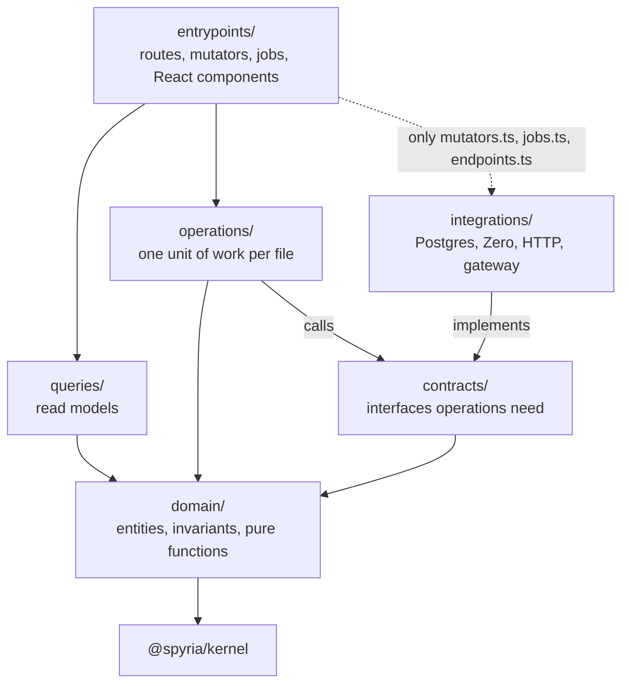

# Contexts and apps

Spyria is one Bun workspace: four apps under `apps/` and one package per bounded context under `packages/`, plus a small shared layer. This page says what each one owns, how it is entered, and how they talk to each other. The rules themselves are in [AGENTS.md](../../AGENTS.md); `bun run check:boundaries` enforces them.

## Why bounded contexts

Each context owns one part of the product and its data rules, and every context has the same internal layout. Knowing one context means knowing where things are in all of them, a change stays inside one folder most of the time, and an import that crosses a boundary the wrong way fails the build instead of slowly tangling the code.

## The layout inside a context

Every arrow is an allowed import (the full list is in [AGENTS.md](../../AGENTS.md)), and all of them point toward `domain/`, the core every other layer builds on. `contracts/` is not a layer between `operations/` and `domain/`: it holds the interfaces `operations/` calls, which `integrations/` implements, so `operations/` never depends on Postgres or HTTP.

| Layer | Holds |
|---|---|
| `domain/` | Entities, value objects, invariants and pure functions. No third-party import. |
| `contracts/` | The interfaces the inner layers need (repositories, gateways), owned by the code that consumes them. |
| `operations/` | One operation per unit of work, named by its verb (`send-message.ts`, `fork-chat.ts`), run inside its own transaction. |
| `queries/` | Read models for the outside world; they may lag the write model. |
| `integrations/` | Outbound adapters that implement contracts: Postgres, Zero, HTTP, the gateway, another context's published entry. |
| `entrypoints/` | Inbound: HTTP endpoints, Zero mutators, jobs, React components and hooks; input validation happens here. |

`operations/`, `queries/` and `integrations/` never import each other. Composition happens in one place per app: `apps/server/src/index.ts` for the server and `apps/web/src/app/factory.ts` for the web app.

## Entries

A context exposes up to three entries in its `package.json`:

| Entry | File | Who may import it |
|---|---|---|
| `@spyria/<context>` | `src/client.ts` | The web app only: components, hooks and commands. |
| `@spyria/<context>/server` | `src/server.ts` | The server, and the web app's composition root (Zero runs the same mutators optimistically in the browser and authoritatively on the server). |
| `@spyria/<context>/published` | `src/published.ts` | Another context's `integrations/` only. |

## The contexts

| Context | Owns |
|---|---|
| `workspace` | The organization: workspaces, members, roles, projects, the chat list, sign-in settings and integrations set up by admins. |
| `conversation` | Everything inside a chat: messages, threads and the agent's turns. |
| `runtime` | Where agents run: runtime hosts, members' own machines and the runtimes on them. |
| `profile` | What belongs to one member: their profile, keys and personal connections. |
| `usage` | Metering: usage, spend, budgets and the audit log. |
| `panel` | The chat's side panel, a read-only view over the other contexts' data. |

### How contexts talk

A context reaches another only from its `integrations/`, through that context's `published.ts`. Everything else meets in the apps: the server composes the contexts' server entries, and the web app composes their client entries. Each context reads and writes its own tables through its own integrations; another context's data arrives through a published entry or through the shared Zero schema.

## The shared layer

| Package | Holds | Who may import it |
|---|---|---|
| `@spyria/kernel` | Ids, typed errors, permissions, logging and other small pure helpers. It imports nothing. | Every layer |
| `@spyria/db` | The database and Zero schemas, synced queries and the Postgres client. | `queries/`, `integrations/`, `entrypoints/` |
| `@spyria/ui` | Shared React components, no business rules. | `entrypoints/` |
| `@spyria/session` | The signed-in member, as the UI reads it. | `entrypoints/` |

## The apps

| App | What it is | Imports |
|---|---|---|
| `apps/server` | The control plane: sign-in, the HTTP and Zero endpoints, the job worker, the agent bridge and the model relay. | Contexts' `server` entries, `kernel`, `db`. |
| `apps/web` | The React app, with its e2e and visual tests. | Contexts' `client` entries and the shared layer. |
| `apps/host` | `spyria-host`, which runs on a runtime host or a member's machine and connects it to the server. | Nothing from `@spyria/*`. |
| `apps/agent` | `spyria-agent`, the process inside a runtime that drives the coding agent. | Nothing from `@spyria/*`. |

Keeping the host and the agent self-contained keeps their images small and their contract with the server explicit: a change to a context cannot silently change what runs on someone else's machine.

See [development](../guides/development.md) for the commands and [overview](overview.md) for how the processes connect.
