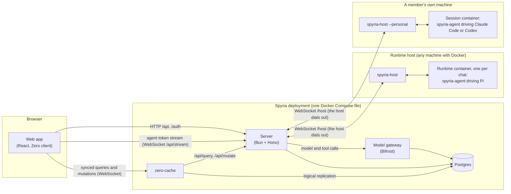
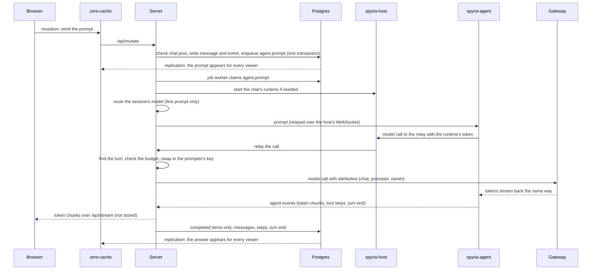

# Architecture overview

This page shows how Spyria's pieces fit together, follows one agent turn from the composer to the stored answer, and says where each kind of state lives. Read it first if you are going to change Spyria or run it; the other architecture pages go one level deeper: [contexts](contexts.md) for the code layout and [security](security.md) for the trust boundaries.

## The system in one diagram

| Piece | What it does |
|---|---|
| Web app | The React app members use. It reads a local replica of the data it is allowed to see and writes through Zero mutators, which apply optimistically in the browser and authoritatively on the server. In production the server serves its build from the same origin. |
| Server | The control plane: sign-in, permissions, Zero's query and mutation endpoints, HTTP endpoints, the job worker, the agent bridge to runtimes, the model and tool relay to the gateway, GitHub publishing and webhooks. |
| zero-cache | Rocicorp Zero's sync service. It replicates Postgres through logical replication (publication `spyria_zero`), keeps a replica, and asks the server which rows each member may see (`/api/query`) and to run each write (`/api/mutate`). |
| Postgres | The source of truth: the data model, the append-only event store and the job queue. The gateway keeps its own database on the same server. |
| Model gateway | Bifrost. It holds members' provider keys and the OAuth tokens of their tool connections, forwards model and MCP calls, and logs usage. Spyria never stores a provider key itself. |
| Runtime host | Any machine with Docker running `spyria-host`. It dials out to the server, runs a fixed set of commands (create, start, stop, remove a runtime and install a harness) and relays traffic between the server and its runtimes. It never opens an inbound port. |
| Runtime | A hardened container from Spyria's runtime image, one per chat, running `spyria-agent`. On workspace hosts `spyria-agent` drives Pi on the prompting member's API keys. |
| A member's own machine | The same host program in personal mode. It runs Claude Code or Codex on the member's own subscription; their sign-in never leaves that machine. See [machines](../features/machines.md). |

## The life of an agent turn

1. **The prompt is a write like any other.** The composer runs a Zero mutator. The server checks that the member has `chat.post` on the chat, applies the prompt rate limit, appends the message and its event, and enqueues an `agent.prompt` job in the same transaction. Either all of it is stored or none of it.
2. **A job starts the turn.** The job worker claims the job from Postgres (`for update skip locked`). It makes sure the chat's runtime is running (a runtime host creates or starts it), routes the session's model on its first prompt, records the active turn (who prompted, who owns the chat), and sends the prompt to `spyria-agent` through the host's relay.
3. **The agent calls the model through Spyria.** The runtime holds only a token Spyria issued for that runtime. Its model calls go to the relay address on the runtime's private network; `spyria-host` forwards them to the server, which finds the active turn, refuses the call if the prompter's budget is used up, and forwards it to the gateway with the prompter's own key and attribution labels. Tool (MCP) calls take the same path, on the chat owner's connections (see [security](security.md#what-the-agent-may-do)).
4. **Tokens stream live; only completed items are stored.** `spyria-agent` numbers its events and keeps a bounded buffer so a reconnecting server misses nothing. The server forwards token chunks to every browser watching the chat over the `/api/stream` WebSocket, and writes only completed items (a finished text segment, a finished tool step, a question, the turn end) to Postgres. Zero then syncs those rows to every viewer.
5. **Usage is metered after the fact.** A job reads the gateway's logs every 10 seconds and records each model call against its prompter, chat owner, chat, turn and session. Budgets and spend read those records.

When a turn delegates work, `spyria-agent` runs sub-conversations in the same runtime, and the same path applies to each. When the member presses **Stop**, an `agent.interrupt` job cancels the turn in the runtime.

## Where state lives

| State | Where | Notes |
|---|---|---|
| Workspaces, members, chats, messages, roles, budgets, audit log | Postgres | Every table except a member's own identity (`users`) carries `workspace_id`. |
| Event history of chats | Postgres, `events` | Append-only: a trigger rejects updates and deletes, except a workspace purge and blanking the text of a deleted message. Every chat's history starts with its `chat.created` event, seeded demo chats included. The `messages` table is a projection that can be rebuilt from it; a fork quotes its source from the history itself. |
| Background work | Postgres, `jobs` | The job queue; no other broker. |
| The browser's view of the data | Each browser's Zero replica, and zero-cache's replica | Rebuilt from Postgres when lost. |
| Provider API keys, tool OAuth tokens, usage logs | The gateway's own database | Spyria keeps a reference to each key and its last four characters. |
| SSO client secrets, GitHub App credentials | Postgres, sealed | Encrypted with `SPYRIA_SECRETS_KEY` (AES-GCM). |
| A chat's working files and agent session files | The runtime's volumes on its host | Kept when the runtime stops, so a resumed session continues. |
| A runtime host's pairing token | The host's state volume | Written once at pairing. |
| Claude Code and Codex sign-ins, installed harnesses | Volumes on the member's own machine | Never sent to the server. |

## Deployment shape

One Docker Compose file (`deploy/compose.prod.yml`) runs Postgres, the migrations, the server with the built web app, zero-cache and the gateway, with optional services for a runtime host on the same machine and a tunnel. A single HTTPS origin routes `/zero/*` to zero-cache and everything else to the server. Runtime hosts and members' machines connect to that origin from wherever they are. See [self-hosting](../guides/self-hosting.md).
